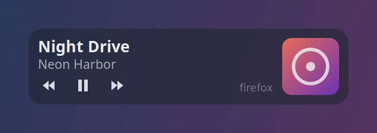
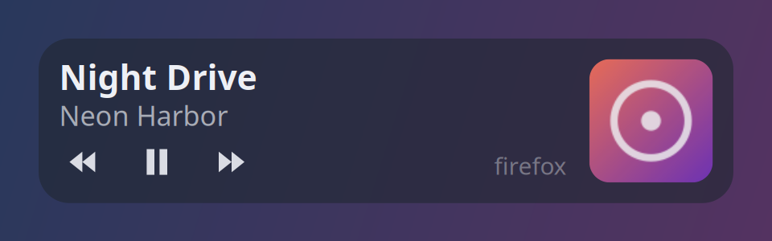

# Tunepeek

Крошечная панель «что сейчас играет» поверх всех окон, даже поверх полноэкранных игр и видео.
Видит YouTube и SoundCloud в браузере, Spotify, VLC: всё, что отдаёт системе информацию о треке.



В свёрнутом виде видна только обложка. Когда начинается новый трек, на 5 секунд выезжает название; если навести курсор, панель раскроется.

| Свёрнута | Ничего не играет | Увеличена |
|---|---|---|
|  |  |  |

| Действие | Что делает |
|---|---|
| ЛКМ по кнопкам | назад / пауза / вперёд |
| ЛКМ + тянуть | переместить |
| Тянуть за край | изменить размер (75–200 %, запоминается) |
| ПКМ | закрыть |

Клики мимо панели проходят насквозь.

## Linux (`linux/`)

Python 3 + GTK 3, данные берёт по MPRIS через D-Bus. Зависимостей сверх системных нет.

```
python3 linux/tunepeek.py            # запуск
python3 linux/tunepeek.py --selftest # самопроверка
```

## Windows (`windows/`)

C# / WPF, данные берёт из медиа-сессий Windows (GSMTC). Готовый `Tunepeek.exe` лежит в Releases.
При первом запуске копирует себя в `%LOCALAPPDATA%\Tunepeek` и добавляет себя в автозапуск (`HKCU\...\Run\Tunepeek`).
Чтобы удалить: закройте панель (ПКМ), удалите эту папку и значение `Tunepeek` в автозапуске.

Сборка (.NET 8 SDK):

```
cd windows && dotnet publish -c Release -o out
```
